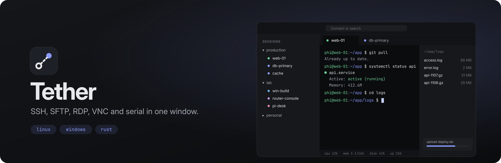

<p align="center"></p>

# Tether

Remote sessions, terminals and files in one window, for Linux and Windows.

SSH with a file browser that follows your shell, SFTP, RDP, VNC, serial consoles, telnet, mosh and
local shells. Saved sessions in folders, tunnels that stay up on their own, split panes, typing into
every terminal at once, and live stats of the server you're on. Bring your sessions over from
MobaXterm, PuTTY or `~/.ssh/config`.

## What it does

| | |
|---|---|
| **SSH** | Agent, key files (passphrases asked once, optionally kept in the keyring), passwords, keyboard-interactive / 2FA. Jump hosts (ProxyJump), X11 and agent forwarding, compression, keep-alive. Host keys checked against `~/.ssh/known_hosts`. |
| **Files** | The SFTP side panel follows the folder you `cd` into. Drag files in from the desktop to upload; download files and whole folders with progress; rename, delete, permissions; **edit in your own editor**: saving uploads it back. |
| **Tabs** | Split right/down (a split reuses the login: no second password or 2FA), duplicate, reorder, reconnect with `R`. |
| **Everything at once** | Multi-exec types into every open terminal; snippets go to one or all. |
| **Tunnels** | Local (`-L`), remote (`-R`) and SOCKS5 (`-D`), through any saved SSH session, reconnecting with back-off, optionally started with Tether. Sessions can also carry their own forwards. |
| **RDP / VNC** | RDP in the system's client (mstsc on Windows, FreeRDP on Linux), VNC right in the tab (noVNC), both optionally tunnelled through an SSH session. |
| **Serial, telnet, mosh, local** | Serial ports with speed/parity/flow; telnet with window-size and terminal-type negotiation; mosh; local shells (PowerShell, cmd, WSL distros and Git Bash on Windows). |
| **Server stats** | CPU, memory, disk, load and uptime of Linux servers under the terminal. |
| **Import** | MobaXterm (`.mxtsessions` / `MobaXterm.ini`), PuTTY (registry or `~/.putty`), OpenSSH config including ProxyJump and forwards. |
| **Secrets** | Passwords live in the OS keyring (Secret Service / Windows Credential Manager), never in Tether's files. |
| **phiOS** | Terminal colours follow the desktop theme (HyDE/wallbash) and change with it. |

Keyboard: `Ctrl+K` connect or search · `Ctrl+Shift+T` local terminal · `Ctrl+Shift+N` new session ·
`Ctrl+Shift+D` / `E` split · `Ctrl+Shift+W` close · `Ctrl+Shift+F` find · `Ctrl+Shift+M` type into
all · `Ctrl+1…4` panels · `Ctrl+Tab` / `Alt+1…9` tabs · `Ctrl+±/0` zoom.

## Layout

- `crates/tether-core`: the engine, UI-agnostic Rust (russh, russh-sftp, portable-pty, serialport,
  tokio). Everything that talks to the network or a terminal lives here and is tested on its own.
- `src-tauri`: the Tauri 2 app, a thin layer of commands over the core.
- `src`: the interface (React, xterm.js, noVNC).
- `dev/`: a preview of the interface against a fake backend, for design work without a server.

## Building

Linux needs WebKitGTK:

```sh
sudo apt install libwebkit2gtk-4.1-dev libsoup-3.0-dev libjavascriptcoregtk-4.1-dev librsvg2-dev libayatana-appindicator3-dev libudev-dev
npm ci
npx tauri dev                   # run it
npx tauri build                 # .deb / .AppImage (Linux), .exe / .msi (Windows)
```

Install for your user (binary in `~/.local/bin`, an entry in the app launcher, registered for
`ssh://` links; no root needed). Run it again to update, `--uninstall` to remove:

```sh
scripts/install-local.sh
```

Windows needs only Rust, Node and the WebView2 runtime (Windows 10/11 have it).

Tests: `cargo test -p tether-core`. The end-to-end check runs the real engine against an `sshd`:

```sh
TETHER_TEST_HOST=127.0.0.1 TETHER_TEST_PORT=22 TETHER_TEST_KEY=~/.ssh/id_ed25519 \
  cargo run -p tether-core --example smoke
```

Interface preview with mocked data: `npx vite --config dev/vite.preview.ts`, then open
`http://localhost:1421/?scene=terminal` (also `split`, `hostkey`, `password`, `transfer`, `editor`,
`palette`, `settings`; add `&theme=light`).

CI is set up to build and test on Linux and Windows on every push and attach the installers to the run.
